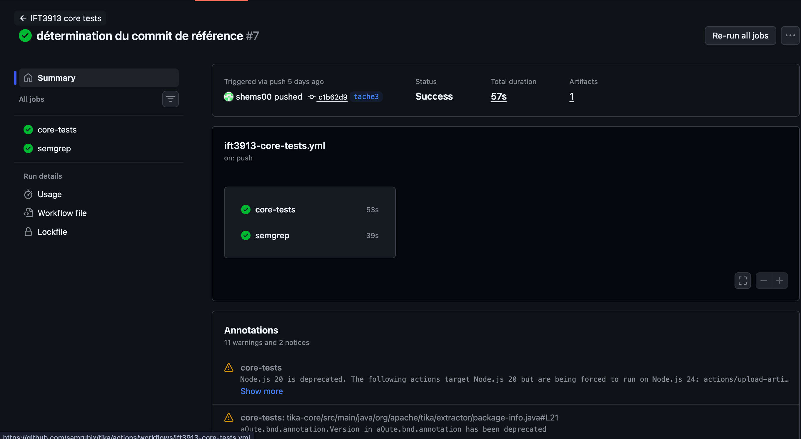
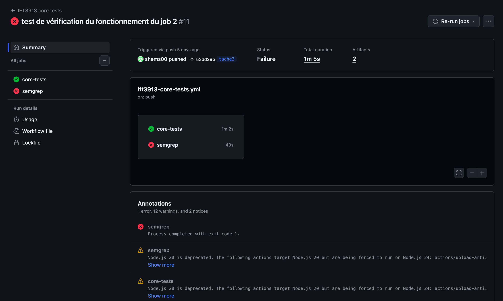
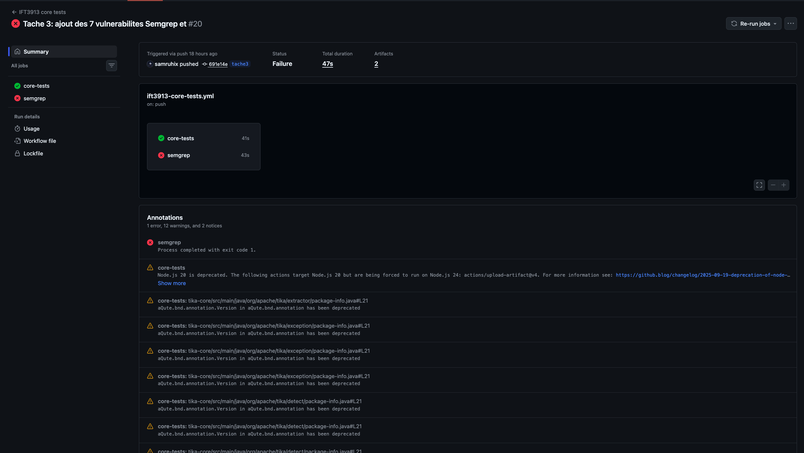
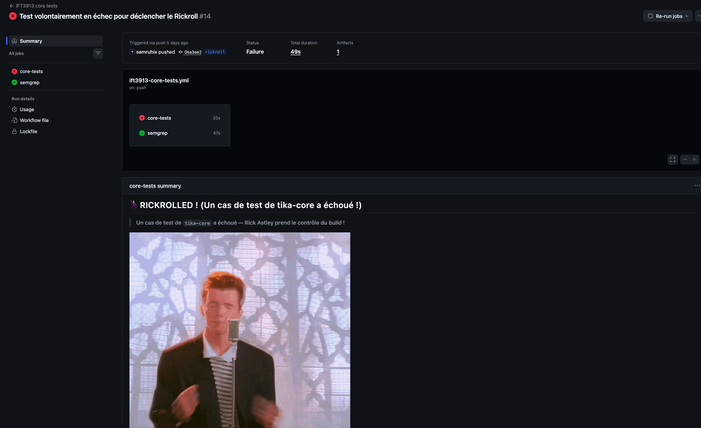

# IFT3913 — Tâche 3

## 1. Workflow : détecter les nouvelles vulnérabilités avec Semgrep

### Objectif

Le but est d'ajouter au workflow un job qui détecte, grâce à Semgrep, les nouvelles
vulnérabilités introduites par chaque commit, et qui fait échouer le build s'il en trouve.

En bref :
- un nouveau job `semgrep`, ajouté dans le même fichier que le job de tests de la tâche 2 ;
- un déclenchement élargi aux cinq modules du cas d'étude ;
- Semgrep exécuté dans son conteneur officiel ;
- une comparaison avec le commit précédent, pour ne bloquer que les vulnérabilités nouvelles.

### Choix de conception

#### Élargissement du filtre `paths`

Avant, le workflow ne se lançait que si `tika-core` changeait. Comme ce filtre s'applique à tout
le fichier, une vulnérabilité ajoutée dans un autre module n'aurait jamais été analysée. Le filtre
couvre maintenant les cinq modules du cas d'étude : `tika-core`, `tika-serialization`, et les
modules PDF, Microsoft et OCR.

#### Conteneur Semgrep

Le job s'exécute dans l'image Docker officielle `semgrep/semgrep`, où Semgrep est déjà installé.
On évite ainsi de l'installer à chaque exécution.

#### Comparaison avec un commit de référence

Tika contient déjà des alertes Semgrep. Si le build échouait dès qu'il y a une alerte, il serait
rouge sur chaque commit, même propre. Avec `--baseline-commit`, Semgrep compare le commit avec un
commit de référence et ne signale que les alertes nouvelles. La référence est :
- pour un push, le commit précédent ;
- pour une pull request, la base de la PR ;
- si aucun commit précédent n'existe (nouvelle branche ou lancement manuel), le point de
  séparation avec `tache2-final`.

#### `fetch-depth: 0`

Par défaut, GitHub ne télécharge que la dernière version du code. Ce réglage télécharge tout
l'historique, sinon le commit de référence n'existe pas sur la machine et la comparaison est
impossible.

#### `--config p/java`

C'est la liste de règles que Semgrep utilise pour chercher les failles : la liste officielle pour
Java, le langage de Tika.

#### `--error`

Sans cette option, Semgrep affiche les failles mais le job reste vert. Avec elle, le job échoue
dès qu'une nouvelle faille est trouvée : c'est ce qui bloque le build.

#### Sauvegarde du rapport

Le résultat de Semgrep est conservé comme fichier téléchargeable dans GitHub Actions, même quand
le job échoue.

### Validation

Pour valider la modification, nous avons poussé trois commits sur la branche `tache3` et observé
à chaque fois le résultat du job `semgrep` dans GitHub Actions.

#### Test 1 : commit sans vulnérabilité

Ce commit ne modifie que le fichier du workflow, sans aucun code Java. Il n'y a donc aucune
nouvelle vulnérabilité, et le job `semgrep` doit réussir. Résultat : le job a réussi ✅ (commit `c1b62d9`).

#### Test 2 : ajout d'une vulnérabilité

Nous avons ajouté dans `tika-core` une classe temporaire, `TestSemgrep.java`, qui chiffre des
données avec `Cipher.getInstance("DES/ECB/PKCS5Padding")`. DES est un chiffrement obsolète, et le
mode ECB laisse voir les motifs du message. Le job `semgrep` doit échouer. Résultat : Semgrep a
détecté deux nouvelles alertes sur cette ligne (`des-is-deprecated` et `ecb-cipher`), et le job a
échoué ❌ (commit `53dd29b`). Le job `core-tests` a réussi sur le même commit : le code compilait et passait tous les
tests, mais le build a bien été bloqué.

#### Test 3 : suppression de la vulnérabilité

Nous avons supprimé `TestSemgrep.java`. Plus aucune nouvelle alerte n'existe, et le job `semgrep`
doit à nouveau réussir. Résultat : le job a réussi ✅ (commit `9f614d9fd`).

Ces trois tests montrent que le job ne bloque le build que lorsqu'un commit ajoute une
vulnérabilité.

---

## 2. Les 7 vulnérabilités introduites dans `tika-core`

Nous avons introduit 7 vulnérabilités de types différents, détectables par Semgrep (`p/java`),
dans des classes pertinentes de `tika-core` :

| # | Fichier modifié & Justification | Type de vulnérabilité | Pourquoi le code est vulnérable | Résultat Semgrep (`p/java`) |
|---|---|---|---|---|
| **1** | `ProcessUtils.java` (`openUnencryptedSocket`) — *Classe utilitaire gérant les processus et communications locales.* | **Socket non chiffré** (CWE-319) | Utilise `new Socket(host, port)` en clair au lieu de `SSLSocket`, exposant les données réseau à l'interception. | **Blocking** : `java.lang.security.audit.crypto.unencrypted-socket` (ligne 298) |
| **2** | `XMLReaderUtils.java` (`createUnsafeDocumentBuilder`) — *Classe centrale de configuration des parseurs XML de Tika.* | **Entités externes XML / XXE** (CWE-611) | Crée un `DocumentBuilderFactory.newInstance()` sans désactiver `disallow-doctype-decl`, permettant les attaques XXE. | **Blocking** : `java.lang.security.audit.xxe.documentbuilderfactory-disallow-doctype-decl-missing` (ligne 1310) |
| **3** | `StringUtils.java` (`unsafeMd5Hash`) — *Utilitaire de manipulation et hachage de chaînes.* | **Hachage faible MD5** (CWE-328) | Utilise `MessageDigest.getInstance("MD5")`, algorithme obsolète sensible aux collisions cryptographiques. | **Blocking** : `java.lang.security.audit.crypto.use-of-md5` (ligne 229) |
| **4** | `Metadata.java` (`createStaticIv`) — *Classe de gestion des métadonnées et propriétés de documents.* | **Vecteur d'initialisation (IV) statique** (CWE-329) | Initialise `new IvParameterSpec(iv)` avec un tableau d'octets fixe codé en dur au lieu d'un IV aléatoire. | **Blocking** : `java.lang.security.audit.crypto.no-static-initialization-vector` (ligne 802) |
| **5** | `Tika.java` (`queryDocumentUnsafe`) — *Façade principale d'interrogation et d'analyse de documents.* | **Injection SQL** (CWE-89) | Concatène directement `docName` dans `stmt.executeQuery("SELECT ... '" + docName + "'")` au lieu d'un `PreparedStatement`. | **Blocking** : `java.lang.security.audit.formatted-sql-string` (ligne 720) |
| **6** | `TikaInputStream.java` (`createWeakCipher`) — *Gestionnaire des flux d'entrée de fichiers.* | **Chiffrement faible AES/ECB** (CWE-327) | Utilise `Cipher.getInstance("AES/ECB/PKCS5Padding")` : le mode ECB chiffre les blocs identiques de façon identique. | **Blocking** : `java.lang.security.audit.crypto.use-of-aes-ecb` & `ecb-cipher` (ligne 509) |
| **7** | `FilenameUtils.java` (`createWeakSslContext`) — *Utilitaire traitant les noms de ressources et URLs.* | **Contexte SSL/TLS obsolète** (CWE-326) | Appelle `SSLContext.getInstance("SSL")` (protocole déprécié) au lieu de `TLSv1.2` ou `TLSv1.3`. | **Blocking** : `java.lang.security.audit.weak-ssl-context` (ligne 422) |

---

## 3. Comparaison des rapports Semgrep (Avant vs Après)

| Critère | Avant modifications (commit de base `98a33b42e`) | Après introduction des 7 vulnérabilités |
|---|---|---|
| **Fichiers ciblés par le scan différentiel** | `0` nouvelle alerte introduite | `7` fichiers Java modifiés dans `tika-core` |
| **Nouvelles vulnérabilités détectées** | **0** *(1 alerte préexistante dans `XMLReaderUtils.java` ignorée grâce à `--baseline-commit`)* | **7 types de vulnérabilités** (**Blocking**) |
| **Statut du job `semgrep`** | ✅ Succès (`exit code 0`) | ❌ Échec (`exit code 1`, commit `691e14e`) |

---

## 4. Rickroll en cas d'échec des tests (`core-tests`)

Le job `core-tests` exécute les tests de `tika-core`. Si un test unitaire échoue
(`failure() && steps.maven-tests.outcome == 'failure'`), l'action composite locale écrite en
Rust (`.github/actions/rickroll`) est compilée (`rustc -O`) et exécutée. Elle affiche une animation ASCII dans
le terminal de la CI, ainsi qu'un GIF Rickroll dans le résumé GitHub Actions
(`$GITHUB_STEP_SUMMARY`, validé sur le commit `0ea3ee2`).

---

## Usage de l'IA

Nous avons utilisé l'IA pour mieux comprendre GitHub Actions et Semgrep, et pour corriger
certaines erreurs.

